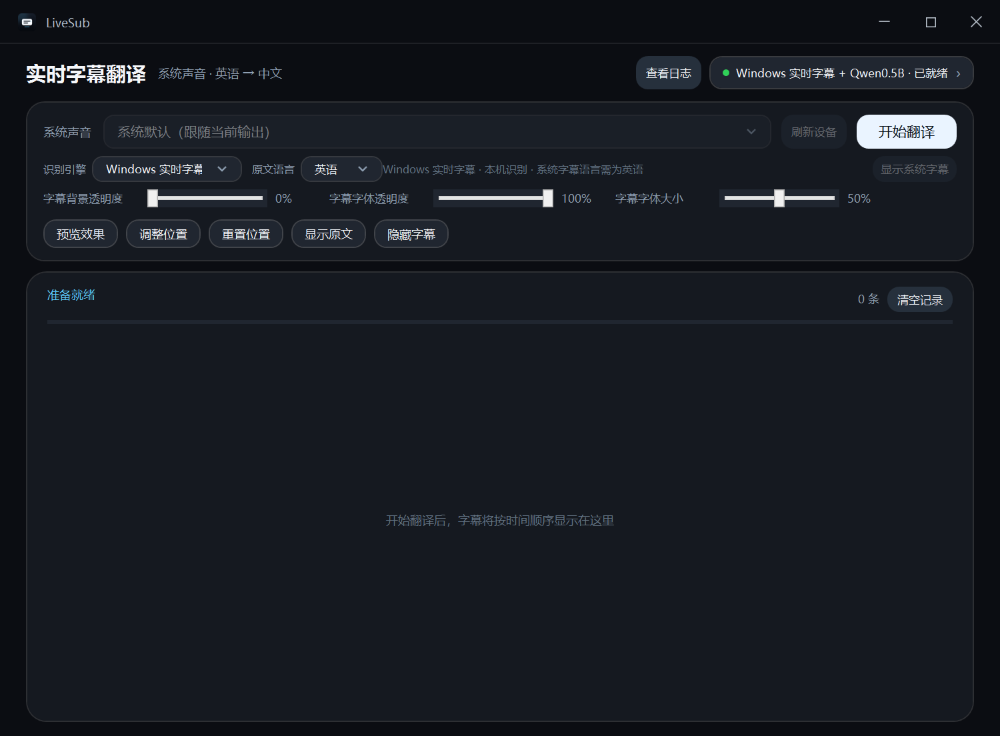

# LiveSub

Windows 本地系统音频字幕：捕获浏览器或任意应用的声音，用 Windows 实时字幕或本地 Whisper 识别，再由本地 Qwen 翻译成简体中文，显示在可调整的悬浮字幕中。识别和翻译都在本机完成，不会上传音频。



## 功能

- WASAPI 系统音频回环捕获，不需要虚拟声卡。
- Windows 实时字幕识别（Windows 11 22H2+，需要英语/日语/韩语语言包）。
- 本地 Whisper 识别；`.en` 模型只支持英文，日语/韩语需要多语言模型。
- 本地 Qwen2.5 GGUF 翻译，支持英语、日语、韩语 → 简体中文。
- 译文流式显示，减少等待完整翻译的时间。
- 悬浮字幕可移动，背景透明度、字体透明度、字体大小分别可调。
- 系统原生字幕可独立显示/隐藏；隐藏时保持透明且不占用底部工作区。
- 模型管理支持 hf-mirror、Hugging Face、ModelScope 回退和断点续传。

## 下载

从 [Releases](https://github.com/Jwforever/livesub/releases) 下载：

- `LiveSub-<version>-win-x64.zip`：便携版。解压后运行 `LiveSub.exe`，不需要安装，也不需要管理员权限。
- `LiveSub-<version>-setup.exe`：按用户安装（默认 `%LOCALAPPDATA%\Programs\LiveSub`），创建开始菜单快捷方式，可从“应用和功能”卸载。

模型不随安装包分发。首次使用时在应用内下载，默认保存到 `%LOCALAPPDATA%\LiveSub\models`，大约需要 2 GB 磁盘空间。安装包未做代码签名，Windows SmartScreen 可能提示“未知发布者”；便携版同样可用。

## 使用

1. 启动 LiveSub。
2. 选择识别引擎：
   - **Windows 实时字幕**：先在 Windows 实时字幕中安装并选择对应语言包；应用会校验系统字幕语言是否与“原文语言”一致。
   - **本地 Whisper**：英文选 `.en` 模型；日语/韩语选 `base` / `small` 等多语言模型。
3. 选择原文语言（英语、日语、韩语）。
4. 点击“开始翻译”，播放系统声音。
5. 用“显示原文/关闭原文”、两个透明度滑块和“字幕字体大小”调整悬浮字幕。
6. “显示系统字幕/隐藏系统字幕”控制系统原生字幕；隐藏时不会保留底部空条。

## 系统要求

- Windows 10 2004+ x64（本地 Whisper 路径）。
- Windows 11 22H2+ 才能使用 Windows 实时字幕。
- 建议 8 GB 以上内存；模型约需 2 GB 磁盘。
- 首次下载模型需要网络；国内优先使用 hf-mirror / ModelScope。

## 构建

```powershell
dotnet build src/LiveSub/LiveSub.csproj
dotnet run --project src/LiveSub/LiveSub.csproj
```

自包含发布（win-x64）：

```powershell
dotnet publish src/LiveSub/LiveSub.csproj -c Release -r win-x64 `
  --self-contained true -p:PublishSingleFile=false -o publish
```

## 测试

文本断句/去重回归：

```powershell
dotnet run --project scripts/caption-tracker-tests/CaptionTrackerTests.csproj
```

悬浮窗回归需要 Windows 桌面环境，手动运行：

```powershell
powershell -ExecutionPolicy Bypass -File scripts/overlay-tests/run-tests.ps1
```

## 分支与发布

- `main`：只保留可发布代码，默认分支。
- `dev`：日常开发分支；先在 `dev` 提交并跑 CI，准备发布时再合并到 `main`。
- Release 只在 `main` 或 `v*` 标签上运行；从 `dev` 手动触发会被跳过。

发布步骤：

1. 在 `dev` 完成开发和测试，推送后等 CI 通过。
2. 合并 `dev` → `main`，再次确认 `main` 的 CI 通过。
3. Actions → Release → Run workflow，输入新版本（例如 `1.0.1`）；或推送 `v1.0.1` 标签。

工作流会运行文本回归、生成自包含便携 ZIP、生成按用户安装包，并创建对应的 GitHub Release。版本号从 **1.0.0** 开始。

## 隐私与许可

音频、识别和翻译均在本机完成；只有下载模型时会访问 hf-mirror、Hugging Face 或 ModelScope。第三方依赖（LLamaSharp、NAudio、Whisper.net）及模型（Qwen2.5、Whisper GGML）遵循各自的许可证。
